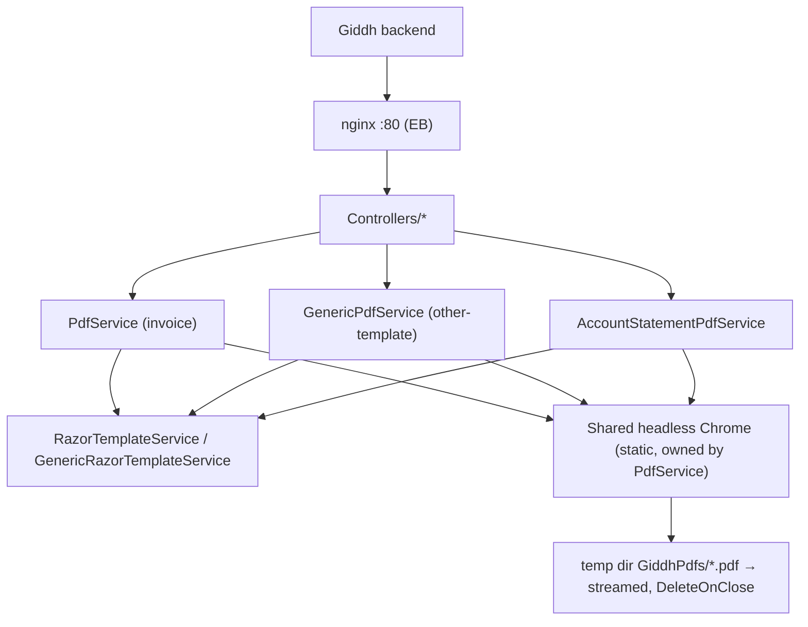

# Architecture & Mental Model

A single .NET 8 ASP.NET Core process (`GiddhTemplate.csproj`) that turns a JSON payload into a PDF: a controller hands the payload to a PDF service, the service renders `.cshtml` templates under `Templates/` to HTML with RazorLight, and one shared headless Chrome (PuppeteerSharp) prints that HTML to a temporary file that is streamed back. There is no database, queue or outbound business call; the only caller is the Giddh backend, server to server (confirmed by the owner, 2026-11-17). Side channels: Serilog (console, files, Loki), OpenTelemetry traces (OTLP), Prometheus metrics, Slack error alerts.

This is a backend service: the template's frontend sections (client state, hydration, routing) are replaced by the PDF pipeline, the browser lifecycle and the hosted services. Endpoint payloads and the metrics/log/alert contracts live in [CONTRACTS.md](CONTRACTS.md); template catalogue, CSS and fonts in [DESIGN.md](DESIGN.md); config keys and deploy in [DEVELOPMENT.md](DEVELOPMENT.md); request journeys and failure recovery in [FLOWS.md](FLOWS.md); the why behind the memory settings in [DECISIONS.md](DECISIONS.md).

## System Overview & Mental Model

Three things to hold in your head:

1. **One Chrome, owned by `Services/PdfService.cs:PdfService`.** The browser is a `static` field; `GenericPdfService` and `AccountStatementPdfService` borrow it through `PdfService.GetBrowserAsync`. Anything that disposes it (`PdfService.DisposeBrowserAsync`) affects every in-flight render.
2. **Memory is the binding constraint.** The hosts are small EB instances; the heap is hard-capped at 800 MB in `runtimeconfig.template.json`, Chrome runs `--single-process` with a 96 MB JS heap, renders are serialised, and the browser is recycled. See [DECISIONS.md](DECISIONS.md) for the incident history.
3. **PDFs go to disk, not memory.** Each service writes to a temp file and the controller streams it with `FileOptions.DeleteOnClose`.

## Entry Points & Bootstrap Sequence

1. **Entry File:** `Program.cs:Main` (top-level `Program` class, `async Task Main`).
2. **Bootstrap Steps** (in order, all in `Program.cs:Main`):
   - Step 1: Process-wide fallbacks: `AppDomain.CurrentDomain.UnhandledException` logs Fatal; `TaskScheduler.UnobservedTaskException` logs and marks observed.
   - Step 2: Builds its own early `IConfiguration` (`appsettings.json` → `appsettings.{ASPNETCORE_ENVIRONMENT or "Development"}.json` → env vars). If `GRAFANA_APP_ENV` is set it overwrites `Serilog:WriteTo:2:Args:labels:1:value` (the `environment` label of the third sink, Loki). Reads `APP_VERSION`, `GRAFANA_APP_ENV`, `ENVIRONMENT`, `SERVICE_NAME`, `GRAFANA_SERVICE_TYPE`, `GRAFANA_COMPANY`, `GRAFANA_PRODUCT`, `SERVER_REGION`, `GRAFANA_ORG_ID` (defaults and meaning: [DEVELOPMENT.md](DEVELOPMENT.md)).
   - Step 3: Creates the static Serilog `Log.Logger`: `ReadFrom.Configuration` (sinks from `appsettings.json`) plus enrichers plus a code-added JSON console sink and JSON file sink `/var/log/template-logs/giddh-template.log` (daily, 30 files). <!-- verify:ignore -->
   - Step 4: `WebApplication.CreateBuilder`; `ClearProviders()` + `UseSerilog()` so Microsoft logging goes only through Serilog.
   - Step 5: OpenTelemetry: resource attributes (service name/version/instance, `deployment.environment`, company, product, region); tracing with `AlwaysOnSampler`, ASP.NET Core (exceptions recorded) and HttpClient instrumentation, source `GiddhTemplate.*`, OTLP/HTTP exporter to `http://127.0.0.1:4318/v1/traces` with `X-Scope-OrgID` when `GRAFANA_ORG_ID` is set; metrics with ASP.NET Core + runtime instrumentation, meter `GiddhTemplate.Metrics`, Prometheus exporter. <!-- verify:ignore -->
   - Step 6: DI registrations (table below), then `builder.Build()`.
   - Step 7: **Browser pre-warm**: resolves `PdfService` and awaits `GetBrowserAsync()`. A launch failure is logged and swallowed so Kestrel still starts; the browser is retried on the first PDF request (commit `8f73021`).
   - Step 8: Registers `PdfService.DisposeBrowserAsync()` on `IHostApplicationLifetime.ApplicationStopping`.
   - Step 9: Middleware, then `app.RunAsync()`. On a startup throw: Fatal log, rethrow; `finally` flushes Serilog.

### DI registrations and lifetimes

| Registration | Lifetime | Why it matters |
|---|---|---|
| `AddHttpClient`, `AddHttpContextAccessor` | framework | Not used by app code today (`SlackService` news up its own `HttpClient`). |
| `ISlackService` → `Services/SlackService.cs:SlackService` | Scoped | Resolved per request, also from `ctx.RequestServices` in the global exception handler. |
| `Services/RazorTemplateService.cs:RazorTemplateService` | Singleton | Holds one RazorLight engine + its compiled-template memory cache. |
| `Services/GenericRazorTemplateService.cs:GenericRazorTemplateService` | Singleton | Second, separate RazorLight engine for `other-template/*`. |
| `Services/PdfService.cs:PdfService` | Singleton | Instance is a façade; the browser, locks, caches and counters are `static`. |
| `Services/GenericPdfService.cs:GenericPdfService` | Singleton | Depends on `PdfService` for the browser and font CSS. |
| `Services/AccountStatementPdfService.cs:AccountStatementPdfService` | Scoped | Its semaphore is `static`, so it is still process-wide. |
| `Services/MemoryReservationService.cs:MemoryReservationService` | Hosted | `IHostedService`; only reachable as a hosted service (see footgun under Diagnostics). |
| `Services/PdfCleanupService.cs:PdfCleanupService` | Hosted | `BackgroundService`. |
| `Services/ChromeRestartService.cs:ChromeRestartService` | Hosted | `BackgroundService`; injects the singleton `PdfService`. |
| `AddControllers` | framework | Attribute-routed controllers in `Controllers/`. |

### Middleware order

`UseExceptionHandler` (global handler) → `UseSerilogRequestLogging` → `MapPrometheusScrapingEndpoint` (`/metrics`) → `MapControllers`. There is no auth, CORS, HTTPS redirection, Swagger or rate limiting middleware: the service relies on network placement (nginx on the EB host proxying to 127.0.0.1:5000, `.platform/nginx/cond.f/elasticbeanstalk/00_application.conf`).

- **Global exception handler** (`Program.cs:Main`, `UseExceptionHandler`): logs the exception with route, method, trace/span id, user agent, remote IP and query; adds an `exception` event to `Activity.Current`; sends a Slack alert via `ISlackService` with environment `ENVIRONMENT` (falls back to the computed environment name); returns `500` JSON `{ error, traceId, timestamp }`. A Slack failure is logged as a warning, never rethrown.
- **Request logging**: one line per request; level is Error for an exception or 5xx, Warning for 4xx or anything slower than 5000 ms, else Information; enriched with host, scheme, query, UA, IP, referer, content length/type, trace/span/parent ids.

### Kestrel, request and runtime limits

| Limit | Value | Where |
|---|---|---|
| Listen address | `http://localhost:5000` | `appsettings.json` `Kestrel:Endpoints:Http:Url` (no Kestrel limits are set in code; framework defaults apply) |
| Request body | 5 MB | `.platform/nginx/nginx.conf` `client_max_body_size` |
| Upstream read timeout | 90 s, or 60 s if not loaded | `.platform/nginx/cond.f/elasticbeanstalk/00_application.conf` `proxy_read_timeout` (if that file is loaded: the folder is named cond.f, not conf.d, so EB may apply the 60 s default instead; see [Q-004](OPEN_QUESTIONS.md)) |
| Managed heap | 800 MB hard limit, workstation concurrent GC, `ConserveMemory` 9, tiered compilation off | `runtimeconfig.template.json` |
| Razor templates | Not compiled into the assembly; copied to output and compiled at runtime by RazorLight | `GiddhTemplate.csproj` (`RazorCompile Remove="Templates/**/*.cshtml"`, `PreserveCompilationContext`) |
| Chrome binary | Shipped as zip parts under `deps/`, copied to publish output | `GiddhTemplate.csproj` (`deps/**`); install is in `.ebextensions/` ([DEVELOPMENT.md](DEVELOPMENT.md)) |

> [!WARNING]
> nginx gives up after 90 s (60 s if the cond.f file is not loaded), but a request can wait up to 90 s for the render slot and then render for up to 2 min (`PdfService.GeneratePdfToFileAsync`). Under a queue, the backend sees a 504 from nginx while the service keeps rendering a PDF nobody will read.

## Major Modules & Responsibilities

| Module / Layer | Path | Core Responsibility | Sources of Truth | May Depend On | Must NOT Depend On |
|---|---|---|---|---|---|
| Host / composition root | `Program.cs` | Config, logging, telemetry, DI, middleware, browser pre-warm and shutdown | `appsettings*.json`, env vars | Everything (wiring only) | Business logic inline |
| Controllers | `Controllers/` | Validate/deserialize body, call one PDF service, stream the temp file, Slack on empty result | HTTP body | PDF services, `ISlackService`, `Models/`, `Converters/` | Chrome/PuppeteerSharp, RazorLight, `Templates/` paths |
| Invoice PDF | `Services/PdfService.cs` | Owns the browser; picks `TemplateA`/`Tally`/`Thermal` files by `TemplateType` + `VoucherType`; assembles header/body/footer + CSS + theme CSS; prints | `InvoiceData.Root` | `RazorTemplateService`, `Models/Enums/` | Controllers |
| Generic PDF | `Services/GenericPdfService.cs` | Maps `templateType` to `Templates/other-template/<name>/Template.cshtml`; renders against a safe dynamic model; injects Inter; prints; falls back to a minimal page on render error | raw `JsonElement` | `GenericRazorTemplateService`, `PdfService` (browser, fonts) | Typed models |
| Account statement PDF | `Services/AccountStatementPdfService.cs` | Renders `Templates/AccountStatement/body.cshtml` + its CSS; prints | `GiddhTemplate.Models.Root` | `RazorTemplateService`, `PdfService` | Controllers |
| Template engines | `Services/RazorTemplateService.cs`, `Services/GenericRazorTemplateService.cs` | Read `.cshtml` from disk, compile + cache by key, render | Template files | RazorLight, `SafePayload` | Chrome |
| Safe payload | `Services/SafeDynamic.cs`, `Services/SafeValue.cs`, `Services/SafeList.cs` | Wrap schema-less JSON so missing keys/odd types render as `""`/0/false/empty instead of throwing | — | BCL only | Anything app-level |
| Template helpers | `Services/TemplateHelpers.cs:TemplateHelpers` | Total helpers (`Has`, `Get`, `Str`, `Dec`, `Int`, `Bool`, `Items`, `ShowCol`, `ColLbl`…) auto-imported into generic templates | — | Safe payload types | Services, I/O |
| Label rendering | `Models/LabelRenderer.cs:LabelRenderer` | Bilingual label markup (inline/stacked, RTL languages) for invoice templates | `Setting`, `LabelDisplayConfig` | BCL, RazorLight `IRawString` | Services |
| Models | `Models/RequestModel.cs`, `Models/AccountStatementRequest.cs`, `Models/Enums/Common.enum.cs` | Typed payloads for invoice and account statement; voucher type enum | Backend JSON | BCL | Services |
| JSON converter | `Converters/NumberToStringConverter.cs:NumberToStringConverter` | Accept a JSON number where the model has `string?` (invoice path only) | — | System.Text.Json | — |
| Alerts | `Services/SlackService.cs:SlackService` | POST `{url, env, error, errorStackTrace}` to `SLACK_WEBHOOK_URL`, 10 s timeout, never throws | env var | `HttpClient` | Controllers |
| Background | `Services/ChromeRestartService.cs`, `Services/PdfCleanupService.cs`, `Services/MemoryReservationService.cs` | Daily Chrome restart, temp-file sweep, optional heap reservation | — | `PdfService` (static API) | Controllers |
| Diagnostics | `Controllers/DiagnosticsController.cs:DiagnosticsController` | Health, memory/GC stats, forced GC | Process/GC | `MemoryReservationService` (attempted) | PDF services |

### Controller → service map

| Controller | Service | Model / input | Template root |
|---|---|---|---|
| `Controllers/PdfController.cs:PdfController` | `PdfService.GeneratePdfToFileAsync` | `InvoiceData.Root` via `NumberToStringConverter`; 400 if `Company.Name` empty | `Templates/TemplateA`, `Templates/Tally`, `Templates/Thermal` |
| `Controllers/GenericPdfController.cs:GenericPdfController` | `GenericPdfService.GeneratePdfToFileAsync` | raw `JsonElement`; 400 only if null/undefined | `Templates/other-template/` |
| `Controllers/AccountStatementController.cs:AccountStatementController` | `AccountStatementPdfService.GenerateAccountStatementPdfToFileAsync` | `GiddhTemplate.Models.Root`; 400 if `AccountName` empty | `Templates/AccountStatement` |
| `Controllers/PdfController.cs:MainController` | — | — | — (`GET /` greeting) |
| `Controllers/DiagnosticsController.cs:DiagnosticsController` | — | — | — |

Routes and response shapes: [CONTRACTS.md](CONTRACTS.md).

> [!WARNING]
> Two unrelated classes are both named `Root`: `InvoiceData.Root` (`Models/RequestModel.cs`) and `GiddhTemplate.Models.Root` (`Models/AccountStatementRequest.cs`). `PdfService` uses the first, `AccountStatementPdfService` the second. Always fully qualify in a file that imports both namespaces.

> [!WARNING]
> `GenericPdfService` maps `TALLY` → `Templates/Tally` and `THERMAL` → `Templates/Thermal`, which have no `Template.cshtml`; the existence check sits outside the render fallback, so those types fail with a 500 on the generic endpoint. It also reads the rename key as `PdfRename` (case-sensitive on a `JsonElement`), so a camel-case `pdfRename` is ignored there.

## PDF Rendering Pipeline & Browser Lifecycle

Here rendering means Razor → HTML → Chrome → PDF.

- **Rendering Pattern:** server-side only. Razor renders full HTML strings in .NET; `page.SetContentAsync(html)` loads them into a fresh Chrome tab; `EmulateMediaTypeAsync(Print)`; `page.PdfAsync(tempFile, A4, PrintBackground, PreferCSSPageSize)`. Fonts are `@font-face` rules pointing at file:// URIs under `Templates/Fonts/` (built by `PdfService.BuildFontCSSAsync`).
- **Boundary:** .NET owns data and HTML; Chrome only lays out and prints. No JavaScript is required by templates; Chrome's JS heap is capped at 96 MB.
- **Fallbacks:** `GenericPdfService` swallows a Razor render error and prints a minimal "could not be rendered completely" page (`GenericPdfService.BuildFallbackHtml`). The invoice and account-statement paths propagate errors to the controller.

### Who owns the browser

| Concern | Owner | Detail |
|---|---|---|
| Browser instance | `PdfService._browser` (`static IBrowser?`) | Created lazily by `PdfService.GetBrowserAsync` (double-checked under `_browserLock`), recreated if `null`, disconnected or closed. Launch: `/usr/bin/google-chrome`, headless, 60 s launch timeout, low-memory flags incl. `--single-process`, `--renderer-process-limit=1`, `--disable-dev-shm-usage`, `--js-flags=--max-old-space-size=96 …`, `--lang=en-US,ar-SA`. |
| Pages | Each generate call | One new page per PDF, closed in `finally`. Never pooled. |
| Disposal | `PdfService.DisposeBrowserAsync` (static) | Called on app stop, by `ChromeRestartService`, and by `PdfService` every 10 invoice PDFs (`_browserRecycleAfter`). |
| Crash recovery | `PdfService` | On `TargetClosedException` sets `_browser = null`; the next `GetBrowserAsync` relaunches. |

### Concurrency limits

| Path | Gate | Wait limit | Render limit |
|---|---|---|---|
| Invoice (`PdfService`) | `static SemaphoreSlim(1,1)` `_pdfGenerationSemaphore` | 90 s, then `TimeoutException` ("service is busy") | 2 min `CancellationTokenSource`; navigation timeout 60 s, `WaitUntil=Load` |
| Generic (`GenericPdfService`) | its own `static SemaphoreSlim(1,1)` | 90 s, then `TimeoutException` | none overall; navigation 15 s, `WaitUntil=DOMContentLoaded` |
| Account statement (`AccountStatementPdfService`) | its own `static SemaphoreSlim(1,1)` | unbounded | new-page 30 s; navigation 30 s, `WaitUntil=Networkidle0` |

> [!WARNING]
> The three semaphores are independent, so up to **three** pages can render at once in the one `--single-process` Chrome, despite comments saying "only one Chrome render at a time". Worse, `PdfService` recycles the shared browser after its own 10th render and `ChromeRestartService` disposes it at 09:00 IST, neither waiting for the generic or account-statement semaphore: a render in flight on those paths fails with a closed-target error. If you change concurrency, introduce one shared gate rather than a fourth semaphore.

> [!WARNING]
> Only `PdfService` has the 2-minute overall cancel and nulls `_browser` on `TargetClosedException`. `GenericPdfService` closes but does not dispose its page and has no overall timeout; `AccountStatementPdfService` waits for its slot forever.

## Background / Hosted Services

| Service | Type | Schedule | What it does |
|---|---|---|---|
| `Services/ChromeRestartService.cs:ChromeRestartService` | `BackgroundService` | Daily at 09:00 Asia/Kolkata (computed each loop with `TimeZoneInfo`) | `pgrep -f 'google-chrome.*headless'` for the old PID → `PdfService.DisposeBrowserAsync()` → wait up to 15 s for that PID to exit, then `Kill()`; if no PID was found, `pkill -9 -f 'google-chrome.*headless'` → `GetBrowserAsync()` to relaunch. Also disposes the browser in `StopAsync`. Exists to clear Chrome processes that survive a dispose (commits `2fba9f1`, `c344300`). |
| `Services/PdfCleanupService.cs:PdfCleanupService` | `BackgroundService` | Every 30 min (first run 30 min after start) | Deletes `*.pdf` in the temp `GiddhPdfs` folder whose `LastAccessTime` is older than 2 h. Safety net for files the request path failed to delete. Does **not** touch `Downloads/`. |
| `Services/MemoryReservationService.cs:MemoryReservationService` | `IHostedService` | Once at start / stop | If `MemoryReservation:Enabled`, allocates and touches a `byte[]` of `MemoryReservation:ReservedMemoryBytes` (default 200 MB, capped at `int.MaxValue`) to hold heap like JVM `-Xms`; releases on stop. Disabled in `appsettings.json` and `appsettings.Production.json`, enabled (200 MB) in `appsettings.Test.json`. Disabled in prod after the memory crisis ([DECISIONS.md](DECISIONS.md)). |

All three run inside the web process; there is no separate worker. The 09:00 IST restart is unconditional, even mid-render.

## Files Written and Cleaned

| What | Where | Written by | Removed by |
|---|---|---|---|
| Output PDF | `Path.GetTempPath()` + `GiddhPdfs/<name>_<guid32>.pdf`; `<name>` is the sanitized `PdfRename`/`AccountName` or `PDF_<yyyyMMddHHmmss>` | all three PDF services | the controller's `FileStream` with `FileOptions.DeleteOnClose` after streaming; the controller `catch` on error; `PdfCleanupService` after 2 h |
| Developer copy | `Downloads/<name>.pdf` (suffix `_1`, `_2`… on clash) under the working directory | `PdfService`, `AccountStatementPdfService` (not `GenericPdfService`) when `ASPNETCORE_ENVIRONMENT` (or, if unset, `ENVIRONMENT`) is `Development`, `Local` or empty | nothing; Downloads/*.pdf is git-ignored (`.gitignore`) |
| Logs | `/var/log/template-logs/` (code sink `giddh-template.log`, 30 days; config sink `giddh-template-.log`, 7 days) | Serilog | Serilog retention <!-- verify:ignore --> |

> [!WARNING]
> The `Downloads/` copy also happens when **no** environment variable is set. The repository does not set `ASPNETCORE_ENVIRONMENT` for Elastic Beanstalk; production relies on the EB `ENVIRONMENT` property being present (read by `.platform/hooks/postdeploy/grafana-setup.sh`). If it is ever missing, every invoice is also kept forever in `Downloads/`.

## Application State Ownership

No database or distributed cache. All state is in-process and lost on restart.

| State Kind | Owner / Tool | Lifespan | Invalidation / Reset Rule |
|---|---|---|---|
| Headless browser | `PdfService._browser` (static) | Until recycle, crash, 09:00 IST restart or app stop | Recycled every 10 invoice PDFs; nulled on `TargetClosedException`; relaunched lazily |
| Render slots | three static `SemaphoreSlim(1,1)` (one per PDF service) + `PdfService._browserLock` | Process | Released in `finally` |
| Template CSS cache (invoice) | `PdfService._stylesCache` (static `ConcurrentDictionary` keyed by template folder) | Process | Never; editing a template's Styles/*.css needs a restart. Generic and account-statement CSS is read from disk every request. |
| Font CSS | `PdfService` static strings per family (Inter, Open Sans, Roboto, Lato) | Process | Never |
| Compiled templates | RazorLight memory cache in each engine; key = template path (generic: path + `::safe-v2`) | Process | Never; bump `GenericRazorTemplateService.CacheVersion` to force recompile of generic templates in a running process (inferred from the key) |
| Render counter | `PdfService._pdfGenerationCount` | Process | Reset to 0 at each recycle |
| Reserved heap | `MemoryReservationService._reservedMemory` | Process | Released on stop |
| Output files | temp GiddhPdfs folder | ≤ 2 h | See Files Written |

## Inbound HTTP & Error Handling

The service has no outbound business API; this section covers inbound calls.

- **Client Wrapper:** none outbound except `SlackService` (own `HttpClient`, 10 s) and the OTLP exporter.
- **Authentication Injection:** none. No endpoint checks a token or key; only network placement protects it (only the Giddh backend calls it, confirmed by the owner, 2026-11-17).
- **Error Handling & Normalization:**
  - `PdfController` and `AccountStatementController` rethrow; the global handler logs, alerts Slack and returns `500 {error, traceId, timestamp}`.
  - `GenericPdfController` catches everything itself, alerts Slack (labelled `api/v1/pdf`, not `api/v1/genericpdf`) and returns `500 {error, details}` with the exception message.
  - An empty file path from a service gets its own Slack alert and `500`.
  - Busy (`TimeoutException` after 90 s) surfaces as a 500, not 429/503.

## Business Rules & Logic Placement

- **Payload validation:** minimal, in controllers (`Company.Name` for invoices, `AccountName` for statements, non-null for generic). Everything else is tolerated by templates.
- **Template selection:** `PdfService.GeneratePdfToFileAsync` (`TemplateType` → `TemplateA`/`Tally`/`Thermal`; `VoucherType` Receipt/Payment → `Receipt_Payment_Body.cshtml`, PurchaseOrder/PurchaseBill → `PO_PB_*`, via `Models/Enums/Common.enum.cs:CommonEnumsExtensions`), `GenericPdfService` (`templateType` switch → `other-template/<folder>`, default `template_a`).
- **Theme maths:** `PdfService.CreatePdfDocumentAsync` (font sizes clamped 1–72, rendered 2 px smaller than requested; margins at least top 10 / right 10 / bottom 15 / left 10 px; `ShowSectionsInline != true` adds `repeat-header-footer` class and `Background.css`).
- **Domain calculations:** none in C#; amounts arrive pre-computed from the backend and templates only format them (inferred: no tax/total arithmetic in `Services/`).

## External Systems & Dependencies

| External System | Purpose | Communication Contract | Location in Code |
|---|---|---|---|
| Giddh backend | Only caller | [docs/CONTRACTS.md](CONTRACTS.md) | `Controllers/` |
| Headless Google Chrome | HTML → PDF | PuppeteerSharp 20.1.1 over DevTools | `Services/PdfService.cs:PdfService` |
| Slack (incoming webhook) | Error alerts | JSON `{url, env, error, errorStackTrace}` | `Services/SlackService.cs:SlackService` |
| Grafana Loki | Logs | Serilog Loki sink configured in `appsettings.json` | `Program.cs:Main` |
| OTLP collector on localhost:4318 | Traces | OTLP/HTTP protobuf | `Program.cs:Main` |
| Prometheus | Metrics scrape | `/metrics` | `Program.cs:Main` |

## Layer Rules

- Controllers call exactly one PDF service and never touch PuppeteerSharp, RazorLight or `Templates/` paths.
- Only `PdfService` launches or disposes Chrome. Other services call `PdfService.GetBrowserAsync()`; never call `Puppeteer.LaunchAsync` elsewhere (a second Chrome on these hosts is how memory incidents start).
- Every page you open is closed in `finally`; every PDF goes to the temp `GiddhPdfs` folder so `PdfCleanupService` can sweep it.
- Generic templates get data only through `SafePayload` + `TemplateHelpers`; do not hand them a raw `JsonElement`.
- Alerts go through `ISlackService`; never log or echo `SLACK_WEBHOOK_URL` (note `SlackService.SendErrorAlertAsync` currently prints it to the console on every alert).

## How to Add a New PDF Type

Pick the path that fits; most new documents should use the generic one.

**A. New generic template (no C# model, schema-less payload)**
1. Create `Templates/other-template/<folder>/Template.cshtml` (layout and CSS rules: [DESIGN.md](DESIGN.md)). Use `Str`, `Dec`, `Items`, `Has` from `TemplateHelpers`; they are auto-imported.
2. Add `"<TEMPLATE_TYPE>" => "other-template/<folder>"` to the switch in `GenericPdfService.GeneratePdfToFileAsyncInternal`. Unknown types silently fall back to `template_a`. The key is read case-sensitively as `templateType` from the JSON.
3. Templates are copied by the `Templates/**` content rule in `GiddhTemplate.csproj`; nothing else to register.
4. Add a sample under `sample-payloads/` and document the `templateType` in [CONTRACTS.md](CONTRACTS.md).

**B. New typed document with its own endpoint (like account statement)**
1. Model in `Models/` under its own namespace; avoid another class named `Root`.
2. Service in `Services/` modelled on `AccountStatementPdfService`: inject `PdfService` and `RazorTemplateService`; get the browser via `GetBrowserAsync`; one page, closed in `finally`; write to the temp `GiddhPdfs` folder; return the path. Reuse an existing gate rather than adding a fourth semaphore (see Concurrency limits), and add a wait timeout.
3. Register it in `Program.cs:Main` (singleton if stateless).
4. Controller in `Controllers/` modelled on `AccountStatementController`: validate, call the service, Slack on empty path, return `File(new FileStream(..., FileOptions.DeleteOnClose), "application/pdf", ...)`, delete the temp file and rethrow on error so the global handler alerts.
5. Update [CONTRACTS.md](CONTRACTS.md), [FLOWS.md](FLOWS.md) and this file's module and controller tables.

**C. New invoice variant (TemplateA/Tally/Thermal family)**: add `.cshtml` files to the folder and extend the `templateFolderName` / `switch` in `PdfService.GeneratePdfToFileAsync`; a new folder needs a Styles folder with Styles.css, Header.css, Footer.css, Body.css (and optional Background.css), as in `Templates/TemplateA/Styles/`, cached for the process lifetime.

## Dead or Unwired Pieces (do not build on them)

- `Program.TryCreateUri`: unused.
- `GenericPdfService.CreatePdfDocumentAsync` (never called) and the result of its `LoadStylesAsync` (loaded, never used: every generic `Template.cshtml` carries its own `<style>`); its `CheckMemoryPressure` only logs.
- Packages `Swashbuckle.AspNetCore` and `Microsoft.AspNetCore.OpenApi` in `GiddhTemplate.csproj`: no Swagger is wired.
- Meter `GiddhTemplate.Metrics` and trace source `GiddhTemplate.*`: subscribed in `Program.cs:Main`, but no code creates them, so there are no custom metrics or spans.
- `DiagnosticsController` asks DI for `MemoryReservationService`, but it is registered only via `AddHostedService`, so the `Reservation` block is always `null`.
- Serilog sinks are defined twice (config and code), so every event is written twice to the console and to two different files.
