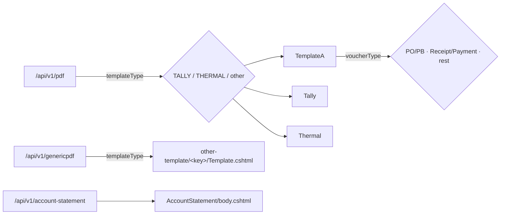

# Document Design & Templates

This service has no web UI. Its visual output is the PDF: Razor (`.cshtml`) templates rendered by RazorLight
into one HTML string, printed by headless Chrome through PuppeteerSharp. "Design" here means the template
catalogue, page geometry, fonts, CSS conventions and the helpers templates call. Frontend-only template
sections (responsive breakpoints, keyboard/ARIA, SEO, website copy) do not apply and are dropped.

Request handling, Chrome lifecycle and memory limits live in [ARCHITECTURE.md](ARCHITECTURE.md); routes and
payload shapes in [CONTRACTS.md](CONTRACTS.md); running locally in [DEVELOPMENT.md](DEVELOPMENT.md).

## Visual & Interaction Principles

1. **The payload decides what prints.** Every block is guarded by a `Settings.<Name>.Display` flag and a non-empty
   value; labels come from the payload (`Setting.Label` / `SecondaryLabel`), not from hardcoded text
   (commit `d352b5b` "remove hardcode labels"). Never print placeholder copy: the "Your Voucher Note will
   display here" default added in `2714c41` has since been replaced by an empty string in
   `Templates/TemplateA/Footer.cshtml`.
2. **Self-contained HTML.** No CDN CSS, JS or web fonts. Remote dependencies were removed in `c5683d8` and
   `aa1e38d` because they caused PDF generation timeouts. Fonts load from `Templates/Fonts/`. The only remote
   fetches left are payload-supplied images (`Company.Logo.Url`, `TypeOfCopy`, signatures).
3. **A render must not fail.** Generic templates read the payload through total helpers
   (`Services/TemplateHelpers.cs:TemplateHelpers`), and a render exception becomes a minimal fallback page
   (`Services/GenericPdfService.cs:BuildFallbackHtml`), commit `e0e23cd`. The typed templates use `?.`
   everywhere for the same reason.
4. **Theme goes through CSS variables.** Font family, the three font sizes and primary/secondary colours are
   injected as `--font-*` / `--color-*` custom properties on `:root, html, body`. Templates use the
   `var(--…, fallback)` form and never hardcode a size or colour that the theme controls.
5. **Same behaviour across templates.** Multi-language labels go through one renderer
   (`Models/LabelRenderer.cs:LabelRenderer`) and the utility classes in each template's styles (`Templates/TemplateA/Styles/Styles.css`, `Templates/Tally/Styles/Styles.css`) are kept in
   step between TemplateA and Tally (recent commits such as `f1b3d29` change both together).

## Template catalogue

### Typed templates (`POST /api/v1/pdf`, model `InvoiceData.Root`)

Selected in `Services/PdfService.cs:GeneratePdfToFileAsync` from `templateType` (upper-cased):
`TALLY` → `Tally`, `THERMAL` → `Thermal`, anything else (including missing, or `TemplateA`) → `TemplateA`.
Rendered with `Services/RazorTemplateService.cs:RazorTemplateService` (no safe wrapper: the model is typed).

| Folder | Files rendered | Serves | Reachable |
|---|---|---|---|
| `Templates/TemplateA/` | `Header.cshtml` + `Body.cshtml` + `Footer.cshtml` | Every voucher type not listed below (Sales, Credit/Debit Note, Proforma, Estimate, Cash…; `Models/Enums/Common.enum.cs:VoucherTypeEnums`) | Live, default |
| `Templates/TemplateA/` | `PO_PB_Header.cshtml` + `PO_PB_Body.cshtml` + `Footer.cshtml` | `voucherType` = `Purchase Order` or `Purchase Bill` | Live |
| `Templates/TemplateA/` | `Receipt_Payment_Body.cshtml` only (no header, no footer) | `voucherType` = `Receipt` or `Payment` | Live |
| `Templates/Tally/` | `Header.cshtml` + `Body.cshtml` + `Footer.cshtml`, plus `Templates/Tally/Styles/Background.css` | Tally-style invoice (bordered grid look); TDS/TCS support added in `3578b66` | Live (`TALLY`) |
| `Templates/Thermal/` | `Body.cshtml` only | Narrow receipt-style invoice (see [Thermal](#thermal-constraints)) | Live (`THERMAL`) |

Voucher-type matching is case-insensitive against the `EnumMember` value (`GetVoucherTypeEnumValue`), so
`"Purchase Order"` matches but `"PurchaseOrder"` does not.

### Account statement (`POST /api/v1/account-statement`, model `GiddhTemplate.Models.Root`)

`Templates/AccountStatement/body.cshtml` with `Templates/AccountStatement/Styles/Styles.css` + `Templates/AccountStatement/Styles/Body.css`, rendered by
`Services/AccountStatementPdfService.cs:AccountStatementPdfService`. Fixed design: Inter, fixed px sizes, no
theme variables, A4 with 20/25/20/20px margins, "Page X of Y" footer via `@page`. Live.

### Generic templates (`POST /api/v1/genericpdf`, schema-less payload)

`Services/GenericPdfService.cs` maps `templateType` (upper-cased) to a folder and renders its single
`Template.cshtml` with `Services/GenericRazorTemplateService.cs:GenericRazorTemplateService`. Each folder also
has a `<folder>.csharp.json`: a sample payload. No code reads those files. These templates were migrated from
the old VM templates in `86d0842`. All 34 folders under `Templates/other-template/` appear in the switch, so all
can be reached through this route. Whether the Giddh backend actually sends each key is not visible here
(see the TODO below). Document types are inferred from folder names and sample keys.

| Folder (`templateType` key = upper-cased name) | Document (inferred) | Lines |
|---|---|---|
| `template_a`, `template_b`, `template_c`, `template_d` | Invoice / proforma (logo variants a, c) | 266–284 |
| `template_e_1` | Simple GST invoice | 145 |
| `gst_template_a`, `gst_template_a_1` | GST invoice | 553–554 |
| `gst_template_a_v2` | GST invoice with theme keys (`font`, `primaryColor`, `label`) | 1203 |
| `gst_template_backup` | GST proforma/invoice. Name says backup but it is mapped (`GST_TEMPLATE_BACKUP`) | 342 |
| `voucher_template_a`, `voucher_tmeplate_b` | Voucher. Keep the misspelling: the key is `VOUCHER_TMEPLATE_B` | 324–356 |
| `transfer_template_a_v1` | Stock transfer (sources, destinations, transporter) | 403 |
| `thermal_template` | Thermal receipt (older generic version) | 426 |
| `tally_template` | Tally invoice (older generic version) | 244 |
| `po_template`, `purchase_order_email_template`, `purchase_bill_email_template` | Purchase order / purchase bill | 155–314 |
| `receipt` | Receipt | 120 |
| `entry` | Entry/line-item table fragment | 99 |
| `bulk_invoice_failure` | List of invoices that failed bulk generation | 129 |
| `ledger_template`, `LedgerTemplate` (keys `LEDGERTEMPLATE`, `LEDGER_TEMPLATE_UPPER`) | Ledger | 65–110 |
| `ledger_admin_condensed`, `ledger_admin_detailed`, `ledger_admin_condensed_company`, `ledger_admin_detailed_company`, `ledger_view_condensed`, `ledger_view_detailed` | Ledger reports (admin / view, condensed / detailed) | 55–70 |
| `daybook_admin_condensed`, `daybook_admin_detailed` | Day book | 122–156 |
| `inventory_report_for_company`, `inventory_report_for_stock`, `stock_report_v2`, `warehouse_report` | Inventory / stock / warehouse reports | 59–81 |

> [!WARNING]
> An unknown `templateType` on `/api/v1/genericpdf` silently renders `other-template/template_a` (the `_` arm of
> the switch). `TALLY` and `THERMAL` on that route map to `Tally`/`Thermal`, which have no `Template.cshtml`.
> `GenericPdfService.RenderTemplate` throws `FileNotFoundException` before its fallback try, so the
> request returns 500 and fires a Slack alert.

> [!TODO]
> Which generic `templateType` values the Giddh backend actually sends is not in this repository. Folders that
> look superseded (`gst_template_backup`, `tally_template` and `thermal_template` next to the typed Tally/Thermal,
> `LedgerTemplate` vs `ledger_template`) need the backend owners to confirm before anything is removed.



## Page geometry & header/footer

All three services call `page.PdfAsync` with `Format = A4`, portrait, `PrintBackground = true`,
`PreferCSSPageSize = true`, `DisplayHeaderFooter = false`, after `EmulateMediaTypeAsync(MediaType.Print)`.

| Path | Margins | Content wait |
|---|---|---|
| Typed (`PdfService`) | `Theme.Margin.*` px, floored at top 10 / right 10 / bottom 15 / left 10 | `Load`, 60s |
| Generic | Fixed 10 / 15 / 10 / 10 px | `DOMContentLoaded`, 15s |
| Account statement | Fixed 20 / 25 / 20 / 20 px | `Networkidle0`, 30s |

Chrome's own header/footer is off. Repeating header and footer on every page is done in CSS:

- `PdfService.CreatePdfDocumentAsync` puts `class='repeat-header-footer'` on `<body>` unless the payload sets
  `showSectionsInline: true`. Inside a flex column it renders header, then body, then footer.
- With that class, `header` / `footer` become `position: fixed` (`Templates/TemplateA/Styles/Header.css`,
  `Footer.css`), so Chrome repeats them on each printed page.
- An inline `<script>` at the end of `Header.cshtml` / `PO_PB_Header.cshtml` (TemplateA, Tally) measures
  `#header` and `#footer` on `load` and writes `--header-height` / `--footer-height`. `Body.cshtml` wraps content
  in `table.repeated-header.repeated-footer`, whose `thead`/`tfoot` hold spacer divs of those heights. Under
  `@media print` they become `table-header-group` / `table-footer-group`, so body rows never sit under the
  fixed header or footer. This is why the typed path waits for `Load`: the script must run before printing.
- In inline mode the spacers are skipped and the footer gets `flex-grow: 1`, so it sits at the end of the
  content, not at the bottom of every page.
- Page numbers come from `@page { @bottom-center { content: "(" counter(page) ")" } }`, hidden on
  `@page:first` (TemplateA, Tally, Thermal). The account statement prints "Page X of Y".
- `Templates/Tally/Styles/Background.css` (a base64 grid image on `body`, marked "Do not Change This Code")
  is appended only in repeat mode.

> [!WARNING]
> Do not remove the height script or the spacer `thead`/`tfoot`. Without them a multi-page invoice prints body
> rows underneath the fixed header and footer.

## Thermal constraints

The `Thermal` template is not sized for a thermal roll. The page is A4 (`@page { margin: 0.5in; size: A4 }`
in `Templates/Thermal/Styles/Styles.css`). The receipt is a single centred `table.thermal-invoice-table` at
`max-width: 60%` (`Templates/Thermal/Styles/Body.css`), with dashed `.dotted-separator` rules and no header/footer files. It uses its
own reflection helpers `GetLabel` / `GetDisplayStatus` (by setting name) and `LblValue` for bilingual
`Message1`. Its `Templates/Thermal/Styles/Styles.css` has no `.lbl-multi` rules, because only `HtmlBlocks` output is used there.

> [!TODO]
> No real roll width (58/80 mm) or printer constraint is expressed anywhere. Whether Thermal PDFs are sent to
> thermal printers, and at what width, needs a human.

## Design tokens & styling primitives

- **Token source:** `@property` declarations at the top of each typed template's `Styles.css`
  (`Templates/TemplateA/Styles/Styles.css`, `Templates/Tally/Styles/Styles.css`, `Templates/Thermal/Styles/Styles.css`).
- **Colours:** `--color-primary` (initial `#181b50`), `--color-secondary` (initial `#ffffff`, used as the
  entry-table header/footer fill), `--color-light` `#262626`, `--color-light-gray` `#777777`. The payload's
  `theme.primaryColor` / `theme.secondaryColor` override the first two.
- **Weights:** `--font-weight-200/400/500/700`. Classes `.font-weight-500`, `.font-weight-700`, `strong` = 700.
- **Sizes:** `--font-size-default` 14px, `--font-size-large` 18px, `--font-size-medium` 12px,
  `--font-size-small` 10px (initial values; overridden at runtime, below). Classes `.font-size-*`. Cell padding
  and line-height are expressed as `calc(var(--font-size-default) * k)`, so spacing scales with the font.
- **Numbers:** `html, body { font-variant-numeric: tabular-nums }` keeps amount columns aligned.

### Runtime theme injection (typed path)

`PdfService.CreatePdfDocumentAsync` concatenates the CSS in the order `Styles.css`, `Header.css`, `Body.css`,
`Footer.css`, then the theme block, then `Background.css`. The theme block comes last so it wins:

- `ResolveFontSizePx` accepts 1–72 from `theme.font.fontSizeDefault/Medium/Small`, else 14/12/10.
- Then `decreaseFontSize = 2` is subtracted: default, medium and small print 2px smaller than requested.
  `--font-size-large` is set to the raw default, not 18px (commits `fe421e9`, `61b35a4`).
- `font-size` is also set explicitly on `:root, html, body`, not only the variable.

### Class conventions

| Class | Rule / use |
|---|---|
| `.message-text` | `font-size: min(var(--font-size-default), 16px)`: caps free-text messages (Message1/Message2) at 16px however large the theme font is (`f1b3d29`). Use it on any payload free-text block. |
| `.text-wrap-pre` | `white-space: pre-wrap`: keeps payload line breaks in notes and addresses (`bd0d73c`). |
| `.lbl-multi`, `.lbl-inline`, `.lbl-stack`, `.lbl-1`, `.lbl-2`, `.lbl-sep` | Emitted by `LabelRenderer`. Stacked labels follow the cell's `.text-center` / `.text-right`. |
| `.entry-table`, `.tax-bifurcation-table`, `.entry-summary` | Line-item, tax-split and totals tables (`Templates/TemplateA/Styles/Body.css`). |
| `.grid-view`, `.grid-columns-4`, `.grid-item` | Field grids (3 columns by default, 4 with the modifier), wrapping long values anywhere. |
| `.repeated-header`, `.repeated-footer`, `.page-break-inside-avoid` | Pagination helpers (see above). |
| `.border-top/-bottom/-left/-right`, `.border-none`, `.hide-background-border` | Borders use `currentColor`. `.hide-background-border` masks the Tally grid background. |
| `.p-0`, `.pd-*`, `.mr-*`, `.px-0`, `.py-0` | Spacing utilities (10px / 5px steps). `.py-0` is defined twice, and the 1px version wins. |
| `.text-right`, `.text-center`, `.vertical-align-*`, `.no-wrap`, `.capitalize-only-first`, `.square-image`, `.signature-image`, `.watermark-image` | Alignment and media. Amount columns are `.text-right`. |

Tally renames fields to one `label-value-line` class (`61ae409`). Table cells controlled by a setting are left
out of the markup entirely, not hidden with CSS (`df1008c`, e.g. the `Unit` column).

## Fonts & scripts

- Files: `Templates/Fonts/{Inter,Lato,OpenSans,Roboto}/<Family>-{Light,LightItalic,Regular,Italic,Medium,MediumItalic,Bold,BoldItalic}.ttf`.
- `PdfService.LoadFontCSSAsync` normalises the family (`ResolveFontFamily`: case-insensitive "open sans",
  "lato", "roboto", "inter"; empty means Inter). It builds `@font-face` rules once per process
  (`BuildFontCSSAsync`, cached in static fields) that point at the TTFs with file URIs (`new Uri(file).AbsoluteUri`), weights 200/400/500/700.
  An unrecognised family name falls through to the Inter CSS but is still written to `--font-family`.
- Every rule has `unicode-range: U+0020-007E, U+00A0-00FF`. The bundled fonts only cover Basic Latin and
  Latin-1. Any other character (₹ U+20B9, Arabic, Devanagari…) falls back to fonts installed on the
  server: `.ebextensions/002_install_fonts.config` installs `google-noto-sans-arabic-fonts` and
  `langpacks-core-font-*`. Chrome is launched with `--lang=en-US,ar-SA`. Locally, glyph fallback depends on your
  OS fonts, so non-Latin output can differ from TEST/PROD.
- Generic path: `GenericPdfService.InjectInterFontCssAsync` inserts Inter and
  `html, body, body * { font-family: 'Inter', Arial, sans-serif !important; }` before `</head>`. So every
  `other-template` renders in Inter, whatever its own CSS declares (Calibri, Open Sans, Helvetica…).
- Account statement: Inter only.

## Labels, multi-language & right-to-left

`Models/LabelRenderer.cs:LabelRenderer` is the single place that turns a `Setting` into printed label markup,
driven by `Root.LabelDisplay` (built from `displayLanguage1`, `displayLanguage2`,
`showLanguage2DisplayedFirst`, `language1Code`, `language2Code`, `separator`; separator defaults to two spaces).
Each typed template declares thin wrappers in its `@functions` block:

| Wrapper | Calls | Use |
|---|---|---|
| `Lbl(setting)` | `LabelRenderer.Html(…, LabelLayout.Inline)` | Normal labels, languages side by side |
| `LblStack(setting)` | `LabelRenderer.Html(…, LabelLayout.Stacked)` | Table headers, languages one above the other |
| `LblText(setting)` | `LabelRenderer.Text` | Comparisons and emptiness checks only (plain text) |
| `LblValue(primary, secondary, css)` | `LabelRenderer.HtmlBlocks` | Values sent in two languages (`Message1` / `SecondaryMessage1`), one `<p>` each |

Rules the renderer enforces, which templates must not re-implement:

- One language selected → plain encoded text, byte-identical to the pre-bilingual output. Only two languages
  emit the `lbl-multi` wrapper.
- A missing language falls back to the other one. Identical text in both prints once.
- Display order is applied in the markup, not via CSS `flex-direction`, because a flipped flex breaks once the
  label wraps (`42dbf11`, `629d8c3`).
- RTL codes (`ar`, `fa`, `he`, `ur`… see `RightToLeftLanguages`) get `lang` + `dir="rtl"` on their span.
- All text is HTML-encoded. Do not wrap the result in `Html.Raw` of payload text yourself.

## Generic template helpers

`Services/TemplateHelpers.cs:TemplateHelpers` is imported into every generic template
(`GenericRazorTemplateService` prepends `@using static GiddhTemplate.Services.TemplateHelpers`). The payload is
wrapped by `SafePayload.From` (`Services/SafeDynamic.cs`): missing keys resolve to a neutral value, member lookup
falls back to case-insensitive, and JSON numbers become `decimal`. Helpers take a dotted path:

| Helper | Returns |
|---|---|
| `Has`, `HasKey`, `IsEmpty` | Presence / emptiness |
| `Str`, `StrOr(src, path, fallback)` | Text (invariant culture), never null |
| `Dec(src, path[, decimals])`, `Int`, `Bool` | Numbers (rounding `AwayFromZero`) and truthiness ("true"/"yes"/"1") |
| `Items`, `CountOf`, `Split` | Collections, empty when absent or the wrong type |
| `HasLabel`, `ShowCol`, `ColLbl` | Table columns: `ShowCol` shows the standard invoice columns when the payload sent no column labels at all |
| `Try(fn, fallback)`, `TryRun(action)` | Isolate one expression or block, logging instead of failing |

Older generic templates still declare a local `HasKey(dynamic, string)`. It keeps working because
`SafeDynamicObject` implements `IDictionary<string, object>`. Behaviour is covered by
`GiddhTemplate.Tests/SafePayloadTests.cs`.

## Money, numbers & dates

- **No formatting in this service.** Amounts are printed as the payload sends them. Amount-in-words is
  computed upstream and arrives as text (`Root.TotalInWords.AmountForAccount/AmountForCompany`,
  `TotalInWordsInAccountsCurrency`). There is no number-to-words code here.
- `Converters/NumberToStringConverter.cs:NumberToStringConverter` is not number-to-words. It is the JSON
  converter `PdfController` registers so a JSON number arriving in a `string?` property is kept as its exact
  raw text (no float round-trip, no reformatting).
- Typed `double?` amounts (`Amount`, `Margin`) print with .NET default `ToString` in the server culture. No
  culture is set in `Program.cs`. Generic values print invariant via `Str`, and `@value` on a `SafeValue`
  uses the current culture (inference from `Services/SafeValue.cs:SafeValue.ToString`).
- Currency: `currencyFormat == "CODE"` prints the ISO code, otherwise the HTML-decoded symbol
  (`WebUtility.HtmlDecode(...Symbol)`). It is placed before the amount for the account currency, and the
  company-currency amount is shown only when `isMultipleCurrency && displayBaseCurrency`.
- Dates are payload strings. The only date formatting is the account statement fallback
  `DateTime.Now.ToString("dd-MM-yyyy")` when `fromDate`/`toDate` are missing.

## Recipe: change a template safely

1. Find the file actually rendered for your case in the catalogue above. To find where a field prints, grep the template for its display setting or model property. For example, the Tally billing block is the `GetDisplayStatus("BillingAddress")` section of `Templates/Tally/Body.cshtml`, and per-field show/hide flags (such as `Pan`) are `Setting` properties in `Models/RequestModel.cs`. Check there and in the sample payloads before assuming the backend sends a field. TemplateA alone has three
   header/body pairs, and a change in `Body.cshtml` does not reach Purchase Order, Purchase Bill, Receipt or Payment.
2. If the change is cross-cutting (a class, a label, a message), make it in TemplateA and Tally (and Thermal if it
   has the block), as recent commits do.
3. Guard new blocks with the setting's `Display` flag and `?.`. Use `Lbl`/`LblStack`/`LblValue` for labels.
   Use `.text-wrap-pre message-text` for free text. Use theme variables, not literal sizes or colours.
4. Keep everything local: no `<link>`, CDN `<script>` or remote `@import`.
5. Restart the app before checking. Compiled templates (RazorLight memory cache keyed by path), CSS
   (`PdfService._stylesCache`) and font CSS are cached for the process lifetime. Edits made while the app is
   running do not show up.
6. Check visually (below) with `showSectionsInline` both unset and `true`, with a long multi-page entry
   list, and with `displayLanguage2: true`.

## Recipe: add a new template

- **Generic (preferred for new document kinds):** create `Templates/other-template/<name>/Template.cshtml` and a
  sample `<name>.csharp.json`. Add `"<NAME>" => "other-template/<name>"` to the switch in
  `GenericPdfService.GeneratePdfToFileAsyncInternal`. Read the payload only through `TemplateHelpers`. Put CSS
  inline in a `<style>` block (the generic path ignores separate CSS files) and expect Inter to be forced.
  `Templates/**` is copied to the output by `GiddhTemplate.csproj`, so no project change is needed.
- **Typed invoice variant:** add a folder with `Header/Body/Footer.cshtml` and `Styles/{Styles,Header,Body,Footer}.css`
  (copy TemplateA's `@property` block and `@functions` wrappers). Add a case to the `templateType` switch and
  the file-selection `switch` in `PdfService.GeneratePdfToFileAsync`. Add any new payload fields to
  `Models/RequestModel.cs` (see [CONTRACTS.md](CONTRACTS.md)).
- Add a sample payload under `sample-payloads/` and note the new key in [CONTRACTS.md](CONTRACTS.md).

## Visual check

- Sample payloads: `sample-payloads/TemplateA-Complete-Sample.json`, `Tally-Complete-Sample.json`,
  `Thermal-Complete-Sample.json`, `MultiLanguage-Labels-Sample.json` (Tally with both languages). The generic
  samples are the `<folder>.csharp.json` beside each generic `Template.cshtml`, e.g. `Templates/other-template/receipt/receipt.csharp.json`.
- POST one to the running service and keep the response:

  ```bash
  curl -s -X POST http://localhost:5000/api/v1/pdf -H 'Content-Type: application/json' \
    -d @sample-payloads/TemplateA-Complete-Sample.json -o /tmp/templatea.pdf
  curl -s -X POST http://localhost:5000/api/v1/genericpdf -H 'Content-Type: application/json' \
    -d @Templates/other-template/receipt/receipt.csharp.json -o /tmp/receipt.pdf
  ```

- When `ASPNETCORE_ENVIRONMENT` (or `ENVIRONMENT`) is `Development`, `Local` or unset, the typed and
  account-statement paths also copy each PDF to `Downloads/` as `<pdfRename>.pdf` (or `<name>_1.pdf`…), which
  is git-ignored. The generic path does not.
- A generic PDF that says "Document could not be rendered completely" means the template threw. The cause is in
  the `[GenericPdfService] Template rendering failed` log line.
- Compare against a PDF from before the change at the same zoom. Check the second page for header overlap and
  check the page number.

> [!TODO]
> There are no golden PDFs or automated visual tests. `GiddhTemplate.Tests` covers only the safe-payload
> helpers. Whether a visual regression check is wanted needs a human.
