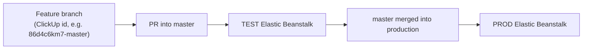

# Development & Verification Guide

How to build, test, run and ship the PDF service, and how an agent proves a change works. Every command below was run on a copy of the repo at `d462f69` on 2026-11-17 (macOS arm64, .NET SDK 8.0.423, Chrome 157). Frontend-only sections of the template (bundlers, lint, browser viewport checks) do not apply: this is a server-to-server ASP.NET Core API whose only caller is the Giddh backend (confirmed by the owner, 2026-11-17).

## Prerequisites & Runtime Environment

- **.NET SDK 8** (`GiddhTemplate.csproj` targets `net8.0`; no `global.json`, so any 8.0.x SDK works). <!-- verify:ignore -->
- **Package manager:** NuGet via `dotnet restore`. No lock file.
- **Google Chrome** on the machine. The service drives a real Chrome binary through PuppeteerSharp; it does not download Chromium.
- **Disk:** a clone is ~150 MB larger than the code suggests, because `deps/` holds the pinned Chrome RPM as two zip parts (90 MB + 49 MB) and every build copies them into `bin/` (`GiddhTemplate.csproj`, `Content Include="deps/**"`). <!-- verify:ignore -->
- No database, no queue, no Docker. Optional at runtime: an OTLP collector on `127.0.0.1:4318` and a Slack webhook; both fail quietly when absent. <!-- verify:ignore -->

## Step-by-Step Setup

1. **Restore** (1.8 s with a warm NuGet cache):
   ```bash
   dotnet restore            # restores GiddhTemplate.csproj only (no .sln in the repo)
   ```
   Expect `warning NU1902` for `OpenTelemetry.Exporter.OpenTelemetryProtocol` 1.8.0 (known moderate advisory). Not fixed yet.
2. **Point the service at a local Chrome.** The path is hard-coded in `Services/PdfService.cs:GetBrowserAsync` as the EB path `/usr/bin/google-chrome`; the macOS and Windows paths sit beside it as comments. There is no config key or env var for it. For a local run, swap the comment **in your working copy only** and never commit it:
   ```csharp
   ExecutablePath = "/Applications/Google Chrome.app/Contents/MacOS/Google Chrome", // Local path MacOS
   // ExecutablePath = "/usr/bin/google-chrome", // Server Google Chrome path
   ```
   > [!WARNING]
   > Committing the macOS path breaks every PDF on EB. History shows this path being flipped back and forth (`3cbec8e` "revert chrome path changes", `cd9f650`, `7317abe` "chrome path fixes"). Check `git diff Services/PdfService.cs` before every commit.
3. **Build** (3.7 s; 12 warnings, 0 errors: CS8603, CS0219, CS0414, CS1998, CS8619 plus NU1902):
   ```bash
   dotnet build
   ```
4. **Run** from the repo root (templates are read from `Directory.GetCurrentDirectory()/Templates`, so the working directory matters):
   ```bash
   dotnet run                # profile "http" from Properties/launchSettings.json → ASPNETCORE_ENVIRONMENT=Development
   curl http://localhost:5000/          # → 200 "Hello from Giddh template!"
   ```
   Ready in about 1 s. The URL is `http://localhost:5000`, set by `Kestrel:Endpoints:Http:Url` in `appsettings.json`. Kestrel config wins over the `applicationUrl` in `Properties/launchSettings.json` (the log says `Overriding address(es) 'http://localhost:5000'`). The `https` profile's port 7255 is therefore never bound. `launchUrl: swagger` opens a 404: Swagger is referenced in the csproj but never registered in `Program.cs`.

Things you will see on a laptop that are not bugs:

- Without step 2, startup logs `Browser pre-warm failed. Service will start and retry on the first PDF request.`, Kestrel still starts (`Program.cs:Main` catches it, since `8f73021`), and every PDF call returns 500 `{"error":"Internal Server Error",...}` with `Win32Exception ... '/usr/bin/google-chrome' ... No such file or directory`.
- `Error: Slack webhook URL is not configured.` means `SLACK_WEBHOOK_URL` is unset, so no alert is sent. Keep it unset locally.
- Every line is logged twice (text + JSON): the sinks in `appsettings.json` plus the extra JSON console/file sinks added in `Program.cs:Main`.
- The file sinks write to `/var/log/template-logs/`, which does not exist on a laptop. Serilog drops those writes silently. <!-- verify:ignore -->
- Port 5000 on macOS: AirPlay Receiver (ControlCenter) listens on `*:5000`. Kestrel still bound `127.0.0.1:5000` and `[::1]:5000` and served correctly, so curl `localhost`, not the LAN IP. <!-- verify:ignore -->
- PDFs from `POST /api/v1/pdf` and `POST /api/v1/account-statement` are also copied to `Downloads/` when the environment is `Development`, `Local` or unset (`Services/PdfService.cs:GeneratePdfToFileAsync`). `Downloads/*.pdf` is git-ignored. <!-- verify:ignore -->

## Environment Variables Reference

All are server-side; nothing reaches a client. Names only — never commit values.

| Variable Name | Required | Client-Exposed | Default Value | Description / Where Read |
|---|---|---|---|---|
| `ASPNETCORE_ENVIRONMENT` | No | No | `Development` in `Program.cs` early config; ASP.NET host default otherwise | Picks `appsettings.<env>.json` (`Development`, `Test`, `Production`). Unset or `Development`/`Local` also turns on the `Downloads/` copy (`Services/PdfService.cs`, `Services/AccountStatementPdfService.cs`). |
| `ENVIRONMENT` | No | No | — | Environment label in Slack alerts (`Controllers/PdfController.cs`, `Controllers/GenericPdfController.cs`, `Program.cs` exception handler); fallback for the `Downloads/` check. On EB it is also the Alloy `env` label (`.platform/hooks/postdeploy/grafana-setup.sh`, default `TEST`). |
| `SLACK_WEBHOOK_URL` | Prod | No (secret) | — | Error-alert webhook (`Services/SlackService.cs:SlackService`). Unset means alerts are skipped. |
| `GRAFANA_APP_ENV` | No | No | — | Overrides the Loki `environment` label and the OpenTelemetry `deployment.environment` (`Program.cs:Main`). |
| `APP_VERSION` | No | No | `1.0.0` | `service.version` on logs and traces. |
| `SERVICE_NAME` | No | No | `giddh-template` | OTel service name, log `Service` property; Alloy `service_name` label on EB. |
| `GRAFANA_SERVICE_TYPE` | No | No | `api` | Log/trace `ServiceType`. |
| `GRAFANA_COMPANY` / `GRAFANA_PRODUCT` | No | No | `Walkover` / `GIDDH` | Log/trace labels. |
| `SERVER_REGION` | No | No | `IN` | Trace `server.region`; Alloy `server_region` label. |
| `GRAFANA_ORG_ID` | No | No | — | Sent as the `X-Scope-OrgID` header on OTLP trace export. |
| `Environment` (config key) | No | No | `Development` | Read only by `Controllers/AccountStatementController.cs` for its Slack label. Nothing sets it, so account-statement alerts always say `Development`. |
| `SERVICE_TYPE` (EB property) | No | No | `API` | Read only by the EB hook, for the Alloy `service_type` label. |

> [!TODO]
> Not determinable from the repository: which of these the TEST and PROD Elastic Beanstalk environments actually set (EB environment properties live in AWS, not in git). This matters in particular for `ASPNETCORE_ENVIRONMENT`: if it is unset on EB, every PDF is also copied into `/var/app/current/Downloads/` and never cleaned up. Needs a human to read the EB configuration. <!-- verify:ignore -->

### Config keys per environment

`Program.cs:Main` loads `appsettings.json`, then `appsettings.<ASPNETCORE_ENVIRONMENT>.json`, then environment variables.

| Key | `appsettings.json` (base) | `Development` | `Test` | `Production` | Read by |
|---|---|---|---|---|---|
| `MemoryReservation:Enabled` | `false` | (base) | `true` | `false` | `Services/MemoryReservationService.cs:MemoryReservationService` (code default `false`) |
| `MemoryReservation:ReservedMemoryBytes` | `0` | (base) | `209715200` (200 MB) | `0` | same (code default 200 MB) |
| `MemoryOptimizations:Enabled` | `true` | — | — | — | **Nothing reads it.** Dead key. |
| `Kestrel:Endpoints:Http:Url` | `http://localhost:5000` | — | — | — | Kestrel. The EB nginx proxy expects 127.0.0.1:5000. |
| `Serilog:*` sinks | Console, File, GrafanaLoki | Console, File | — | — | `Program.cs` via `ReadFrom.Configuration` |
| `Logging:LogLevel:Default` | `Information` | `Information` | `Information` | `Information` | unused in practice: `Program.cs` clears providers and uses Serilog |

> [!WARNING]
> .NET merges JSON arrays by index. `appsettings.Development.json` replaces `Serilog:WriteTo:0` and `:1` but not `:2`, so the GrafanaLoki sink from `appsettings.json` (labelled `environment=Production` unless `GRAFANA_APP_ENV` is set) stays active on a laptop. Inferred from the merge rule, not observed on the wire. Set `GRAFANA_APP_ENV=Local` when running locally if Loki is reachable from your machine.

### Runtime (GC) settings

`runtimeconfig.template.json` asks for an 800 MB heap hard limit, Workstation GC, `ConserveMemory=9` and tiered compilation off (from the 2026-04-02 memory incident, see [DECISIONS](DECISIONS.md)).

> [!WARNING]
> **Server GC is still on.** `dotnet publish -c Release` writes `"System.GC.Server": true` into `GiddhTemplate.runtimeconfig.json`. `Microsoft.NET.Sdk.Web` sets `ServerGarbageCollection=true`, and MSBuild properties override the template. The other template values (heap limit, ConserveMemory, TieredCompilation) do get through. To really get Workstation GC, the csproj needs `<ServerGarbageCollection>false</ServerGarbageCollection>`. Not changed in this docs-only pass.

## Build & Preview Verification

```bash
dotnet publish -c Release -o ./out    # 1.3 s incremental; output ~176 MB
```

Check that the publish output has everything EB needs: `Templates/`, `.ebextensions/`, `.platform/`, `deps/` (both `.part*` files), `appsettings*.json`, and `GiddhTemplate.runtimeconfig.json`. All of these are `Content Include` items in `GiddhTemplate.csproj`, because `EnableDefaultContentItems` is `false`. A new file type under one of these folders ships automatically. A new top-level folder does not ship until you add it to the csproj.

`Templates/**/*.cshtml` are runtime RazorLight templates: they are removed from `RazorCompile`/`RazorGenerate`, so `dotnet build` does **not** compile them. A broken template only fails when a request renders it.

## Running Automated Checks & Tests

| Check Suite | Command | What It Validates |
|---|---|---|
| Type Checking | `dotnet build` | C# compile. Nullable warnings CS8602/CS8604/CS8600/CS8601/CS8618 are suppressed in the csproj (`NoWarn`). Does not compile `.cshtml` templates. |
| Linting & Formatting | — | None configured (no `.editorconfig`, no analyzers). |
| Unit / Component Tests | `dotnet test GiddhTemplate.Tests` | 9 xUnit tests in `GiddhTemplate.Tests/SafePayloadTests.cs` for the missing-key / wrong-type tolerance of `Services/SafeDynamic.cs:SafePayload` and `Services/TemplateHelpers.cs:TemplateHelpers`. 4.7 s, `Passed: 9`. |
| End-to-End Tests | manual, see checklist | Render sample payloads through the running service and open the PDF. |

> [!WARNING]
> Run `dotnet test GiddhTemplate.Tests`, not `dotnet test`. With no `.sln`, a bare `dotnet test` at the root builds `GiddhTemplate.csproj`, finds no tests, and exits 0 **without running anything**.

How the two projects relate: `GiddhTemplate.Tests/GiddhTemplate.Tests.csproj` has a `ProjectReference` to `../GiddhTemplate.csproj`. The main csproj, which sits in the parent folder and would otherwise glob the test sources, excludes them with `Compile Remove="GiddhTemplate.Tests/**"` and `Content Remove="GiddhTemplate.Tests/**"`. Keep both lines if you move or add test projects. No test covers controllers, Chrome, or templates.

No CI in the repo: there is no `.github/`, `buildspec.yml` or other pipeline file. Nothing runs these checks automatically. <!-- verify:ignore -->

## Safe Test-Data Guidance

- **Sample payloads** in `sample-payloads/` are synthetic, safe to POST locally, and all four rendered a PDF on 2026-11-17:

  | File | Endpoint | `templateType` | Result |
  |---|---|---|---|
  | `sample-payloads/TemplateA-Complete-Sample.json` | `POST /api/v1/pdf` | `TemplateA` | 200, 2 pages, 279 KB, 2.5 s (first call, includes Chrome warm-up) |
  | `sample-payloads/Tally-Complete-Sample.json` | `POST /api/v1/pdf` | `TALLY` | 200, 1 page, 286 KB, 1.3 s |
  | `sample-payloads/Thermal-Complete-Sample.json` | `POST /api/v1/pdf` | `THERMAL` | 200, 1 page, 74 KB, 0.15 s |
  | `sample-payloads/MultiLanguage-Labels-Sample.json` | `POST /api/v1/pdf` | `TALLY` (bilingual labels) | 200, 1 page, 151 KB, 0.3 s |

- **Generic / `other-template` templates** (`POST /api/v1/GenericPdf`) have no sample payloads. Because of `SafePayload`, a sparse body like `{"templateType":"RECEIPT"}` renders a mostly empty but valid PDF (verified for `RECEIPT`, `VOUCHER_TEMPLATE_A`, `TEMPLATE_A`). An **unknown** `templateType` silently falls back to `other-template/template_a` with status 200 (`Services/GenericPdfService.cs:GeneratePdfToFileAsync`), so check that the PDF shows *your* template.
- **Account statement** (`POST /api/v1/account-statement`) has no sample payload.
- **Real-shaped payloads:** the older docs describe capturing one from the TEST Giddh web app (`test.giddh.com`) by adding `debugMode=true` to the voucher download call; that call is on the Giddh backend, not in this repo. Use TEST only, never production customer data, and do not commit captured payloads: they contain real company and customer details. <!-- verify:ignore -->
- Keep `SLACK_WEBHOOK_URL` unset locally so test failures do not alert the team channel.

## How an Agent Checks Its Work (Verification Checklist)

1. **Baseline:** `dotnet build` (0 errors) and `dotnet test GiddhTemplate.Tests` (9 passed) before changing anything.
2. **Implementation:**
   - `dotnet build`: 0 errors and no *new* warnings (the current 12 are the baseline).
   - `dotnet test GiddhTemplate.Tests`. Add a test there when you change `Services/SafeDynamic.cs`, `Services/SafeValue.cs`, `Services/SafeList.cs` or `Services/TemplateHelpers.cs`.
3. **Render and look:** templates are not compiled at build time, so a green build proves nothing about them.
   - Set the local Chrome path (setup step 2), `dotnet run`, then for each template family you touched:
     ```bash
     curl -s -o /tmp/out.pdf -w "%{http_code}\n" -X POST http://localhost:5000/api/v1/pdf \
       -H 'Content-Type: application/json' -d @sample-payloads/TemplateA-Complete-Sample.json
     ```
   - Expect `200` and a `%PDF` file. **Open it** (or convert page 1 to an image, e.g. `sips -s format png out.pdf --out out.png` on macOS) and check layout, fonts, Arabic/bilingual text, totals and page breaks.
   - For an `other-template/*` change, POST to `/api/v1/GenericPdf` with that template's `templateType` and confirm it is not the `template_a` fallback.
   - Watch the console for `[PdfService]` errors. `GET /api/diagnostics/health` should return `Healthy`, and `GET /metrics` should serve Prometheus text. <!-- verify:ignore -->
   - Local Chrome (157 on the verifying machine) is newer than the pinned EB Chrome 154. Treat pixel-level differences with care.
4. **Restore before committing:** put back the `/usr/bin/google-chrome` line, stop the server, and delete stray files in `Downloads/`.
5. **Docs:** if you changed a route, payload, config key, env var, EB file or template, update the owning doc ([CONTRACTS](CONTRACTS.md), this file, [DESIGN](DESIGN.md), [ARCHITECTURE](ARCHITECTURE.md)) in the same change, and record the reason in [DECISIONS](DECISIONS.md) when it reverses an earlier choice.

## PR Workflow & Deployment Pipeline

### Promotion Pipeline: `master` (TEST) → `production` (PROD)

Confirmed by the owner, 2026-11-17.



### Flow Steps
1. **Branch** from `master`, named by ClickUp task id, often `<id>-master` (for example `86d4c6km7-master-v1`, PR #296). `*-child` and `*-fixes` branches (`master-child`, `prod-fixes`) are used for merges.
2. **Self-verify** with the checklist above. No CI runs on the PR.
3. **PR into `master`.** A merge deploys to the TEST EB environment.
4. **Verify on TEST** through the Giddh TEST app.
5. **Merge `master` into `production`.** That deploys to PROD.
6. Rollbacks in history are done as GitHub "Revert" PRs (`revert-<n>-<branch>`, e.g. PR #285 reverting #283).

> [!TODO]
> Not determinable from the repository: what turns a merge into an EB deploy (CodePipeline/CodeBuild, the EB CLI, or manual upload), and whether it runs `dotnet publish`. The only hint is the error text in `.ebextensions/001_install_chromium.config` ("csproj Content Include + CodeBuild copy"). Needs a human.

### What runs on an EB instance at deploy

Files in `.ebextensions/` run as root, in filename order, on every deploy (`container_commands` run after the app bundle is staged).

| File | Does |
|---|---|
| `.ebextensions/001_install_chromium.config` | Joins `deps/google-chrome-stable-154.0.8037.97-1.x86_64.rpm.zip.part*` (searched in `.`, `/var/app/staging`, `/var/app/current`), unzips, removes any installed `google-chrome-stable`, installs the 154 RPM, disables the Google yum repo, adds `exclude=google-chrome-stable` to dnf/yum config, and **fails the deploy** unless `google-chrome-stable --version` reports 154.0.8037.97. No internet download. |
| `.ebextensions/002_install_fonts.config` | `yum update -y`, installs `google-noto-sans-arabic-fonts`, `fontconfig` and `langpacks-core-font-*`, then `fc-cache`. Its script starts with a stray `content: |` line before `#!/bin/bash`; it still runs because there is no `set -e`. |
| `.ebextensions/003_add_grafana_repo.config` | Downloads Grafana Alloy 1.12.2 RPM from GitHub releases, installs it, runs it as root. |
| `.ebextensions/004_log_folder.config` | Recreates `/var/log/template-logs` (wipes old logs) with mode 777. <!-- verify:ignore --> |
| `.ebextensions/005_memory_optimization.config` | sysctl: `vfs_cache_pressure=200`, `min_free_kbytes=51200`, `swappiness=10`, dirty ratios 10/5, `overcommit_memory=1`. Disables transparent huge pages, drops caches. |
| `.ebextensions/swap.config` | Creates a 4 GB `/swapfile` once. Sets `swappiness=100` at runtime but appends `vm.swappiness=10` to `/etc/sysctl.conf`, which conflicts with 005 until the next sysctl reload. <!-- verify:ignore --> |

`.platform/` (Amazon Linux 2+ platform hooks):

- `.platform/hooks/postdeploy/grafana-setup.sh` reads EB environment properties `ENVIRONMENT`, `SERVER_REGION`, `SERVICE_TYPE`, `SERVICE_NAME` via `get-config` (fallbacks `TEST`, `IN`, `API`, `giddh-template`). It writes `/etc/alloy/endpoints.json` and `/etc/alloy/config.alloy`, then restarts Alloy. Alloy tails nginx and `/var/log/template-logs/*.log` to Loki, scrapes node metrics and the app's `127.0.0.1:5000/metrics`, and receives OTLP traces on 4317/4318 for Tempo. <!-- verify:ignore -->
- `.platform/nginx/nginx.conf` replaces the EB nginx config: `client_max_body_size 5M`, 60 s client timeouts, gzip off, and `include conf.d/elasticbeanstalk/*.conf` inside the server block.

> [!WARNING]
> `.platform/nginx/cond.f/elasticbeanstalk/00_application.conf` (proxy to `127.0.0.1:5000`, 90 s proxy timeouts) is in a folder named `cond.f`, not `conf.d`, so the `include` above does not match it. Inferred: EB's generated default proxy config is used instead, and the 90 s timeouts are not in effect. A PDF waits up to 90 s for a render slot plus a 2 min render budget (`Services/PdfService.cs`), longer than nginx's 60 s default `proxy_read_timeout`. Confirm on an instance before relying on either value. <!-- verify:ignore -->

> [!WARNING]
> `.platform/hooks/postdeploy/grafana-setup.sh` is committed as mode `100644`. EB runs platform hooks only when they are executable. Inferred risk: the hook may not run unless the deploy pipeline sets `+x`. Check `/var/log/eb-hooks.log` on an instance. <!-- verify:ignore -->

## Repository Oddities

- `deps/` keeps 139 MB of Chrome RPM in plain git (split below GitHub's 100 MB file limit after a Git LFS attempt was reverted, see [DECISIONS](DECISIONS.md)). Every clone and every bin folder gets a copy.
- `.DS_Store` and `Downloads/Readme.md` are tracked. The readme's IronPdf snippet (`pdf.SaveAs`) is obsolete. <!-- verify:ignore -->
- `bin/` and `obj/` are ignored and not tracked. `.gitignore` has duplicated blocks, a literal `*.json (except for package.json ...)` line that matches nothing, and `*.xml`/`*.dll`/`*.exe` patterns. <!-- verify:ignore -->
- `GiddhTemplate.http` still calls the template's `GET /weatherforecast/`, which does not exist.
- `Properties/launchSettings.json` profiles all open `swagger`, which is not served.
- Packages `Swashbuckle.AspNetCore` and `Microsoft.AspNetCore.OpenApi` are referenced but unused (no `AddSwaggerGen`/`UseSwagger`/`AddOpenApi` in `Program.cs`). <!-- verify:ignore -->
- `Services/SlackService.cs:SendErrorAlertAsync` prints the full webhook URL to stdout on every alert, and stdout ends up in EB logs. Treat EB log bundles as containing a secret.
