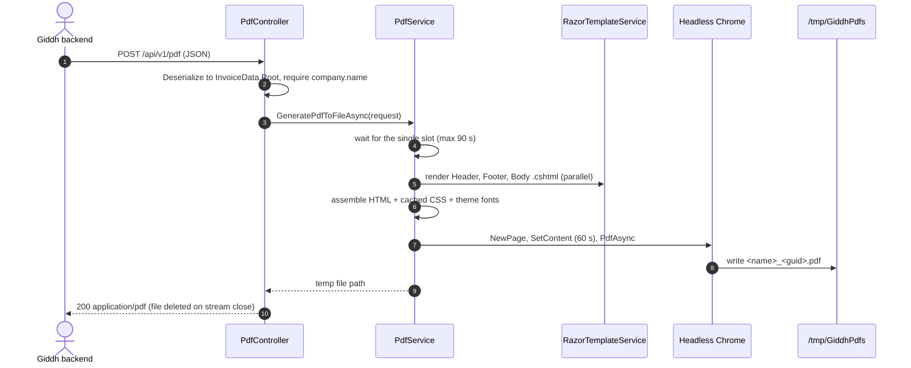

# Flows: request journeys, failure and recovery

Every journey here starts with the Giddh backend posting JSON to this service, server to server; no browser calls it (confirmed by the owner, 2026-11-17). Each ends with a PDF streamed back from a temporary file, or a 4xx/5xx JSON body. There are no pages, routes or client state: this is a backend service, so the template's UI-only sections (route guards, optimistic updates, toasts) are dropped.

Payload schemas and the response contract live in [CONTRACTS.md](CONTRACTS.md); how Chrome, Razor and the background services are wired is in [ARCHITECTURE.md](ARCHITECTURE.md); the template catalogue is in [DESIGN.md](DESIGN.md).

## Core User Journeys Map

| Flow Name | Trigger / Starting Route | Target Outcome | Primary Route & Component |
|---|---|---|---|
| Invoice / voucher PDF | `POST /api/v1/pdf` | `invoice.pdf` from `Templates/TemplateA/`, `Templates/Tally/` or `Templates/Thermal/` | `Controllers/PdfController.cs:GeneratePdfAsync` → `Services/PdfService.cs:GeneratePdfToFileAsync` |
| Generic (report / other-template) PDF | `POST /api/v1/genericpdf` | `document.pdf` from one `Templates/other-template/<name>/Template.cshtml` | `Controllers/GenericPdfController.cs:GeneratePdfAsync` → `Services/GenericPdfService.cs:GeneratePdfToFileAsync` |
| Account statement PDF | `POST /api/v1/account-statement` (also `/api/v1/AccountStatement`) | `account-statement.pdf` from `Templates/AccountStatement/body.cshtml` | `Controllers/AccountStatementController.cs:GenerateAccountStatementPdfAsync` → `Services/AccountStatementPdfService.cs:GenerateAccountStatementPdfToFileAsync` |
| Diagnostics | `GET /api/diagnostics/health`, `GET /api/diagnostics/memory`, `POST /api/diagnostics/gc` | JSON snapshot / forced GC | `Controllers/DiagnosticsController.cs:DiagnosticsController` | <!-- verify:ignore -->

Route names come from `[Route("api/v1/[controller]")]`, so the generic route is the controller name lowercased (ASP.NET matching is case-insensitive). `GET /` returns a plain "Hello" string (`Controllers/PdfController.cs:MainController`).

---

## Detailed Journey: Invoice / voucher PDF

### 1. Happy Path Sequence



### 2. Step-by-Step Path & Code Connections

1. **Request & route**
   - `Controllers/PdfController.cs:GeneratePdfAsync` takes the body as `JsonElement` and deserializes it to `InvoiceData.Root` (`Models/RequestModel.cs:Root`) with case-insensitive names and `Converters/NumberToStringConverter.cs:NumberToStringConverter`, so a JSON number sent for a `string` field is accepted as its text.
   - If the result is null or `company.name` is empty → `400 {"error": "Invalid request data. ..."}` and nothing else runs.
2. **Slot and memory check** — `Services/PdfService.cs:GeneratePdfToFileAsync`
   - `CheckMemoryPressure` logs a warning when managed memory exceeds 70% of the GC's total available memory, at most every 30 s. It only logs; it never rejects or throttles.
   - `_pdfGenerationSemaphore` (1 slot) is awaited for up to 90 s; on timeout it throws `TimeoutException("PDF generation service is busy...")`.
   - A 2-minute `CancellationTokenSource` then bounds page creation and is checked before `SetContentAsync` and `PdfAsync`.
3. **Template selection** — same method, by request fields:

   | `templateType` (upper-cased) | Folder | `voucherType` (case-insensitive) | Files rendered |
   |---|---|---|---|
   | `TALLY` | `Templates/Tally/` | any | `Header.cshtml`, `Body.cshtml`, `Footer.cshtml` |
   | `THERMAL` | `Templates/Thermal/` | any | `Body.cshtml` only |
   | anything else, or missing | `Templates/TemplateA/` | `Receipt` or `Payment` | `Receipt_Payment_Body.cshtml` only |
   | | | `Purchase Order` or `Purchase Bill` | `PO_PB_Header.cshtml`, `PO_PB_Body.cshtml`, `Footer.cshtml` |
   | | | anything else | `Header.cshtml`, `Body.cshtml`, `Footer.cshtml` |

   The `voucherType` strings come from `Models/Enums/Common.enum.cs:VoucherTypeEnums` via `GetVoucherTypeEnumValue`. An unknown `templateType` silently falls back to TemplateA; there is no error for it.
4. **Render** — `Services/PdfService.cs:RenderTemplate` → `Services/RazorTemplateService.cs:RenderTemplateAsync`, which reads the `.cshtml` and calls RazorLight `CompileRenderStringAsync` keyed by the file path, against the typed `Root` model (no `SafePayload` wrapping on this path). Header, footer and body render in parallel with `Task.WhenAll`; receipt/payment and thermal render the body alone.
5. **Assemble HTML** — `Services/PdfService.cs:CreatePdfDocumentAsync`
   - CSS from `<folder>/Styles/{Styles,Header,Footer,Body,Background}.css` via `LoadStylesAsync`, cached per folder in a static dictionary for the process lifetime.
   - Theme CSS appended last so it wins: font from `LoadFontCSSAsync` (Inter, Open Sans, Lato or Roboto; anything else gets Inter's `@font-face`), sizes from `theme.font.*` clamped to 1–72 px (defaults 14/12/10) and reduced by 2 px except "large", colours from `theme.primaryColor` / `theme.secondaryColor`.
   - `showSectionsInline != true` adds `Background.css` and the `repeat-header-footer` body class.
6. **Chrome** — `GetBrowserAsync` returns the shared static browser, launching it if null or disconnected (launch timeout 60 s). `SetContentAsync` waits for `Load` with a 60 s timeout, then print media is emulated and `PdfAsync` writes A4 with margins `max(theme.margin.*, top 10 / right 10 / bottom 15 / left 10 px)`.
7. **File & response**
   - File: `Path.GetTempPath()/GiddhPdfs/<pdfRename or PDF_yyyyMMddHHmmss>_<guid>.pdf` (`pdfRename` is sanitized by `SanitizeFileName`). The download name in the response is always `invoice.pdf`; `pdfRename` only changes the temp and dev-copy names.
   - When `ASPNETCORE_ENVIRONMENT` (or, if unset, `ENVIRONMENT`) is `Development`, `Local` or empty, the PDF is also copied to `Downloads/` with `_1`, `_2` suffixes for duplicates.
   - A forced gen-2 GC runs, the path is returned, and the controller streams it with `FileOptions.DeleteOnClose`.
8. **Finally** (always) — the page is closed and disposed; `_pdfGenerationCount` is incremented and every 10th render disposes the browser (`_browserRecycleAfter`) so the next request launches a fresh Chrome; the slot is released.

### 3. Alternative Paths & Conditional Branches

- **Empty result:** if the service returns a path that does not exist, the controller sends a Slack alert itself and returns `500 {"error": "Failed to generate PDF!"}`.
- **Browser not running** (first request after a failed pre-warm, a recycle, a crash or the daily restart): step 6 launches Chrome inside the request, adding launch time to it.

### 4. Permissions, Roles & Guard Rails

- No authentication or authorization exists in code: `Program.cs` adds no auth middleware and no controller has `[Authorize]`. Access control is assumed to be network-level (only the Giddh backend can reach it).

> [!TODO]
> Not determinable from the repository — how the Elastic Beanstalk environment restricts who can reach port 80 (security groups, VPC). Needs a human; see [OPEN_QUESTIONS.md](OPEN_QUESTIONS.md).

### 5. Failure Modes & Recovery Paths

| Failure Scenario | Where Caught | UI Feedback | Recovery / Fallback Action |
|---|---|---|---|
| Body is not an invoice (`company.name` missing) | `Controllers/PdfController.cs:GeneratePdfAsync` | `400 {"error": ...}` | Caller fixes payload; no Slack alert |
| JSON type mismatch the converter can't absorb | `System.Text.Json` throws → global handler | `500 {"error":"Internal Server Error", traceId, timestamp}` | Slack alert with route and trace id |
| Razor compile or runtime error in a `.cshtml` | Bubbles out of `RazorTemplateService.RenderTemplateAsync` → global handler | 500 | No fallback on this path (unlike generic); fix the template |
| Slot busy > 90 s | `GeneratePdfToFileAsync` throws `TimeoutException` | 500 via global handler | Caller retries; no 429/503 is sent |
| Render > 2 min | `OperationCanceledException` → `TimeoutException` | 500 | Slot released in `finally` |
| Chrome crashed (`TargetClosedException`) | `GeneratePdfToFileAsync` sets `_browser = null`, rethrows | 500 | Next request relaunches Chrome |
| Content load failed (`NavigationException`) | rethrown as `Exception("...Unable to load content...")` | 500 | — |
| Chrome launch failed | `GetBrowserAsync` logs, nulls `_browser`, rethrows | 500 | Retried on every following request |

---

## Flow: Generic PDF (other-template)

`POST /api/v1/genericpdf` with any JSON object renders one schema-less template, picked by name, against a model where missing keys never throw.

### Steps
1. **Accept any object** — `Controllers/GenericPdfController.cs:GeneratePdfAsync`. Only a `null`/undefined body is rejected (`400 "Request body cannot be empty."`). The `JsonElement` is passed to the service unchanged.
2. **Slot** — `Services/GenericPdfService.cs:GeneratePdfToFileAsync` → `GeneratePdfToFileAsyncInternal`. Its own static 1-slot semaphore, 90 s wait, same `TimeoutException`. `CheckMemoryPressure` here logs above a fixed 800 MB and also never throttles.
3. **Pick the template by name** — `templateType` is read with `GetPropertyValue`, which on a `JsonElement` uses `TryGetProperty` and is therefore **case-sensitive**: the key must be exactly `templateType`. Its value is upper-cased and matched against a fixed `switch` (e.g. `LEDGER_VIEW_DETAILED` → `Templates/other-template/ledger_view_detailed/`, `TALLY` → `Templates/Tally/`, `THERMAL` → `Templates/Thermal/`). Unknown or missing names fall back to `Templates/other-template/template_a/`. Two keys map to `Templates/other-template/LedgerTemplate/` (`LEDGER_TEMPLATE_UPPER`, `LEDGERTEMPLATE`); the misspelled folder `voucher_tmeplate_b` is matched by the equally misspelled key `VOUCHER_TMEPLATE_B`. The full list is in [DESIGN.md](DESIGN.md).
4. **Folder check** — if the folder does not exist → `DirectoryNotFoundException`. Only `Template.cshtml` in the folder is rendered.
   > [!WARNING]
   > `TALLY` and `THERMAL` point at `Templates/Tally/` and `Templates/Thermal/`, which have no `Template.cshtml`. `RenderTemplate` checks `File.Exists` **before** its `try`, so the `FileNotFoundException` escapes the fallback. The request fails with 500 and a Slack alert. These two names never render on this route.
5. **Render** — `Services/GenericPdfService.cs:RenderTemplate` → `Services/GenericRazorTemplateService.cs:RenderTemplateAsync`:
   - wraps the payload with `SafePayload.From` (`Services/SafeDynamic.cs`): unknown keys return `SafeMissing`, key lookup falls back to case-insensitive, numbers become `decimal`;
   - prepends the `@using` lines for `Services/TemplateHelpers.cs:TemplateHelpers` (`Has`, `Str`, `Dec`, `Items`, …) unless the template already has them;
   - compiles under the cache key `<path>::safe-v2`.
   If the Razor render itself throws (the template file exists), `RenderTemplate` logs it to the console and returns `BuildFallbackHtml`: a one-page "Document could not be rendered completely" notice naming the template folder. **The caller still gets 200 and a PDF.** No Slack alert is sent for this.
6. **Fonts** — `InjectInterFontCssAsync` inserts Inter `@font-face` plus `font-family: 'Inter' ... !important` before `</head>`, so every generic template renders in Inter regardless of its own CSS.
7. **Chrome** — shared browser from `PdfService.GetBrowserAsync`; `SetContentAsync` waits for `DOMContentLoaded` with a 15 s timeout; A4, fixed margins top 10 / right 10 / bottom 15 / left 10 px; page closed in `finally`.
8. **Response** — temp file named from `PdfRename` (exact key, case-sensitive, same lookup as step 3), streamed as `document.pdf` with delete-on-close.

### Data at key hops
```json
{ "templateType": "LEDGER_VIEW_DETAILED", "PdfRename": "optional-name", "...": "any keys the template reads" }
```

### Errors
- Exceptions inside the service (missing folder, slot timeout, Chrome failures) are caught by the controller: it deletes any temp file, sends Slack (with `url` labelled `api/v1/pdf`, not `genericpdf`), and returns `500 {"error": "PDF generation failed", "details": <exception message>}`. They never reach the global handler.
- Template data problems do not fail the request (step 5).

### Side effects
- One temp file in the GiddhPdfs temp folder; no dev `Downloads/` copy on this path.
- Unlike the invoice path it has no 2-minute overall timeout, does not dispose the page (only `CloseAsync`), does not count toward the 10-render browser recycle, and does not force a GC.
- `Styles` loaded by `LoadStylesAsync` (lower-case common.css, body.css, … in the template folder) are never used, and `CreatePdfDocumentAsync` is never called: the template's own HTML is the whole document.

---

## Flow: Account statement

`POST /api/v1/account-statement` renders one ledger account's transactions from a typed `GiddhTemplate.Models.Root` (`Models/AccountStatementRequest.cs:Root`, not the invoice `Root`).

### Steps
1. **Validate** — `Controllers/AccountStatementController.cs:GenerateAccountStatementPdfAsync` round-trips the body through `JsonSerializer` (case-insensitive, no number-to-string converter). Null or empty `accountName` → `400` with a plain string body.
2. **Slot** — `Services/AccountStatementPdfService.cs:GenerateAccountStatementPdfToFileAsync` awaits its own static 1-slot semaphore **with no timeout**.
3. **Page** — shared browser via `PdfService.GetBrowserAsync`; `NewPageAsync` bounded to 30 s.
4. **Render** — `RazorTemplateService.RenderTemplateAsync` on `Templates/AccountStatement/body.cshtml` (no header/footer files); CSS from `Templates/AccountStatement/Styles/Styles.css` and `Templates/AccountStatement/Styles/Body.css`, read from disk every time (not cached); Inter font CSS prepended in `CreateAccountStatementDocumentAsync`.
5. **Chrome** — `SetContentAsync` waits for `Networkidle0` with a 30 s timeout; A4, margins 20/25/20/20 px.
6. **File & response** — `AccountStatement_<accountName>_<timestamp>_<guid>.pdf` in the GiddhPdfs temp folder, dev copy to `Downloads/` under the same environment rule as invoices, streamed as `account-statement.pdf`.

### Errors
- Empty result → controller Slack alert + `500 {"error": "Failed to generate account statement PDF!"}`. Its Slack `env` comes from configuration key `Environment` (default `Development`), unlike the other controllers which read the `ENVIRONMENT` env var.
- All other exceptions are rethrown to the global handler (500 + Slack). On `TargetClosedException` the service does **not** null the browser; `GetBrowserAsync` still relaunches because it checks `IsConnected`.

### Side effects
- Temp file; dev `Downloads/` copy; does not count toward the 10-render recycle.

---

## Shared failure and recovery paths

### Concurrency and timeouts observed in code

| Limit | Value | Where |
|---|---|---|
| Invoice renders at once | 1 | `Services/PdfService.cs:_pdfGenerationSemaphore` |
| Generic renders at once | 1 (separate semaphore) | `Services/GenericPdfService.cs:_pdfGenerationSemaphore` |
| Account statements at once | 1 (separate, no wait timeout) | `Services/AccountStatementPdfService.cs:_pdfGenerationSemaphore` |
| Slot wait (invoice, generic) | 90 s | `WaitAsync(TimeSpan.FromSeconds(90))` |
| Invoice overall render | 2 min | `CancellationTokenSource(TimeSpan.FromMinutes(2))` |
| `SetContentAsync` | 60 s invoice / 15 s generic / 30 s statement | each service |
| Chrome launch | 60 s | `Services/PdfService.cs:GetBrowserAsync` |
| Browser recycle | every 10 invoice renders | `_browserRecycleAfter` |
| Slack webhook call | 10 s | `Services/SlackService.cs:SendErrorAlertAsync` |
| nginx proxy timeouts | 90 s read/connect/send; body ≤ 5 MB | `.platform/nginx/cond.f/elasticbeanstalk/00_application.conf`, `.platform/nginx/nginx.conf` |

> [!WARNING]
> The three semaphores are independent and all three share one static Chrome. Up to three pages can render at once (one per route), even though each comment says "single concurrent PDF". The 10-render recycle and the daily restart call `PdfService.DisposeBrowserAsync` without taking any of the semaphores, so a generic or account-statement render in flight at that moment loses its page (`TargetClosedException` → 500). Inferred from the code; no incident record found.

> [!WARNING]
> A queued invoice can wait 90 s for the slot and then render for up to 2 min, longer than the 90 s nginx `proxy_read_timeout`. The Giddh backend can see a gateway timeout while the service is still working, and the PDF is then written and deleted unseen. Also, nginx includes conf.d/elasticbeanstalk/*.conf, while the 90 s file sits under `.platform/nginx/cond.f/`; if that directory name is not picked up on the instance, nginx defaults (60 s) apply. Inferred; needs confirming on an instance.

### Global exception handler and Slack

`Program.cs` registers `UseExceptionHandler`. For any exception a controller does not catch (invoice and account-statement routes rethrow everything; generic catches its own), it:
1. logs `Log.Error` with route, method, trace and span ids, user agent, remote IP and query string;
2. adds an `exception` event to the current OpenTelemetry activity;
3. calls `ISlackService.SendErrorAlertAsync(route, ENVIRONMENT or environment name, "<Type>: <message>" + context, stack trace)`; a Slack failure is only logged as a warning;
4. returns `500 {"error": "Internal Server Error", "traceId", "timestamp"}`.

`Services/SlackService.cs:SendErrorAlertAsync` posts `{url, env, error, errorStackTrace}` to `SLACK_WEBHOOK_URL`; when the variable is unset it prints a line and sends nothing. It never throws. Request logging (`UseSerilogRequestLogging`) marks ≥500 as Error, ≥400 or > 5 s as Warning. Alert and log field contracts: [CONTRACTS.md](CONTRACTS.md).

> [!WARNING]
> `SlackService.SendErrorAlertAsync` writes the full webhook URL to stdout on every alert ("Sending error alert to Slack webhook URL: ..."), and stdout is shipped as logs. Treat that URL as exposed wherever logs are readable.

### Chrome lifecycle in a request's life

| Event | What happens | Code |
|---|---|---|
| Startup | Browser pre-warmed; a launch failure is logged and Kestrel starts anyway | `Program.cs` (calls `PdfService.GetBrowserAsync`) |
| Every request | Relaunch if `_browser` is null, disconnected or closed (double-checked under `_browserLock`) | `Services/PdfService.cs:GetBrowserAsync` |
| Every 10 invoice renders | Browser disposed; next request relaunches | `Services/PdfService.cs:GeneratePdfToFileAsync` (`finally`) |
| Daily 09:00 IST | Capture Chrome PID with `pgrep -f 'google-chrome.*headless'`, dispose browser, wait up to 15 s for that PID then kill it (or `pkill -9` when no PID was found), launch a new browser | `Services/ChromeRestartService.cs:ExecuteAsync` |
| Shutdown | Browser disposed (from both `ApplicationStopping` and `ChromeRestartService.StopAsync`) | `Program.cs`, `Services/ChromeRestartService.cs:StopAsync` |

The daily restart and the recycle replace the `BrowserHealthService` (every 6 h / 1000 PDFs) proposed in `MEMORY_CRISIS_RCA_AND_FIXES.md`, which was never added. Background-service wiring is in [ARCHITECTURE.md](ARCHITECTURE.md); the incident and why concurrency is 1 are in [DECISIONS.md](DECISIONS.md). <!-- verify:ignore -->

### Memory pressure

- No route rejects work for memory. Both `CheckMemoryPressure` methods only log.
- The process is bounded by `runtimeconfig.template.json` (`System.GC.HeapHardLimit` 800 MB, workstation GC, `ConserveMemory` 9) and Chrome by `--js-flags=--max-old-space-size=96 ...` and `--single-process` in `GetBrowserAsync`. Values and rationale: [ARCHITECTURE.md](ARCHITECTURE.md), [DECISIONS.md](DECISIONS.md).
- `Services/MemoryReservationService.cs:StartAsync` allocates and touches `MemoryReservation:ReservedMemoryBytes` (default 200 MB, not the 1 GB its comment says) when `MemoryReservation:Enabled` is true. `appsettings.json` and `appsettings.Production.json` disable it; `appsettings.Test.json` enables 200 MB. If the allocation fails it rethrows, which stops the host from starting.

### Temp file cleanup

- Normal path: the response `FileStream` uses `FileOptions.DeleteOnClose`, so the file goes when the response stream closes; controllers delete it themselves when an exception happens after it was written.
- Backstop: `Services/PdfCleanupService.cs:ExecuteAsync` wakes every 30 min (first run 30 min after start) and deletes `*.pdf` in the GiddhPdfs temp folder whose `LastAccessTime` is older than 2 h. Failures are logged and never stop the loop.
- `Downloads/` copies made in Development/Local are never cleaned (they are git-ignored by `.gitignore`).

---

## Flow: Diagnostics

For on-call engineers and load balancer checks, not for the Giddh backend. None of these routes require authentication.

| Route | Returns | Use it to |
|---|---|---|
| `GET /api/diagnostics/health` | Static `{status: "Healthy", timestamp, service, version: "1.0.0"}` | Check Kestrel is up. It does **not** check Chrome, the slot, or memory |
| `GET /api/diagnostics/memory` | Managed/working-set/private/virtual MB, GC counts per generation, thread and handle counts, uptime, `reservation` | Watch memory growth between Chrome recycles |
| `POST /api/diagnostics/gc` | Before/after managed MB and MB freed | Last-resort relief when managed memory is high; it does nothing for Chrome's memory |
| `GET /metrics` | Prometheus scrape (`MapPrometheusScrapingEndpoint`) | Dashboards; metric names in [CONTRACTS.md](CONTRACTS.md) |

> [!WARNING]
> `reservation` in `/api/diagnostics/memory` is always `null`. `DiagnosticsController` resolves `MemoryReservationService` with `GetService<MemoryReservationService>()`, but `Program.cs` registers it only through `AddHostedService`, which registers it as `IHostedService`, not as its own type. The old runbook check `jq '.Reservation'` therefore cannot confirm the reservation setting; read the `MemoryReservation` keys in the deployed appsettings instead. Responses are camelCase (`memory`, `reservation`), not PascalCase.

Runbook when PDFs are slow or failing (carried from `MEMORY_CRISIS_RCA_AND_FIXES.md`, checked against current code):
1. `GET /api/diagnostics/memory` and the instance's `free -h`; check `ps aux | grep chrome` for more than one Chrome.
2. Search logs for `TargetClosedException`, `Launching new browser instance`, `queue timeout`, `timed out after 2 minutes`.
3. Count files in `/tmp/GiddhPdfs`; many old files mean cleanup or delete-on-close is failing.
4. A Chrome restart happens by itself after 10 invoice renders or at 09:00 IST; there is no endpoint to force one. Restarting the app process also relaunches Chrome.
